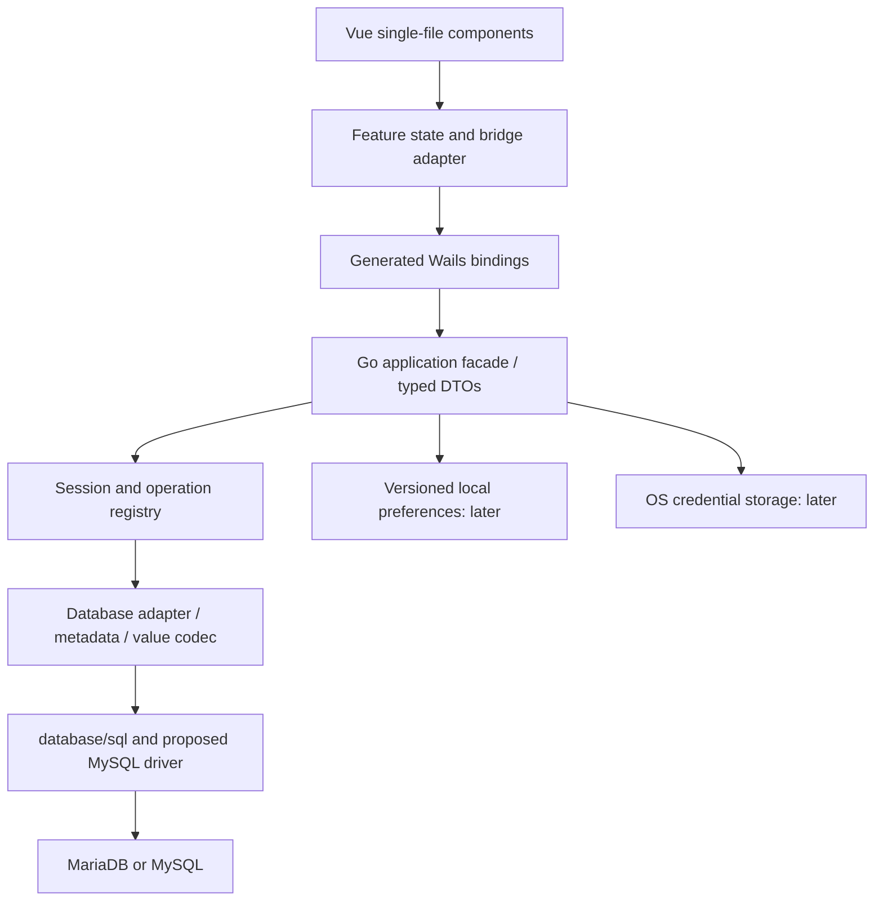

# Querylight architecture and build guide

This is the implementation roadmap and day-to-day build guide. Read it with [architecture.md](architecture.md) for database/session/value rules and [product.md](product.md) for UX scope. The checklist below is the source of truth for completion; check an item only when its stated evidence exists.

Status as of 2026-10-15: the Wails demo builds on Windows. Product database features have not been implemented. Earlier build results are recorded evidence, not a claim that every later change has been tested.

## System architecture



The frontend must never open database connections. Go converts database values to lossless bounded DTOs before returning them. Events notify the frontend of operation state; result retrieval remains possible if an event is missed. A session ID identifies backend-owned state, not a frontend-owned connection.

### Current files and planned responsibilities

| Location | Responsibility | Current state |
| --- | --- | --- |
| `main.go` | Window configuration, dependency composition, startup/shutdown hooks | Scaffold; Querylight window title |
| `app.go` | Thin bound application facade | Greeting demo only |
| `internal/application/` | Connection, browsing, execution use cases and DTOs | Planned |
| `internal/session/` | Dedicated editor connections, operation registry, cancellation, cleanup | Planned |
| `internal/database/` | Driver config, schema metadata, inspection, value codec | Planned |
| `internal/preferences/` | Versioned metadata/preferences/history policy | Later |
| `internal/credentials/` | OS secret-store adapter | Later |
| `frontend/src/features/connections/` | Connect form and connection state | Planned |
| `frontend/src/features/browser/` | Schema/table navigation | Planned |
| `frontend/src/features/editor/` | SQL text, execution controls, editor integration | Planned |
| `frontend/src/features/results/` | Virtualized grid and value inspection | Planned |
| `frontend/src/services/` | Typed Wails wrapper and error/status mapping | Planned |
| `frontend/src/components/` | Shared accessible presentation | Demo component present |
| `frontend/wailsjs/` | Generated Go bindings and Wails runtime | Present; never hand-edit |
| `assets/branding/` | Editable approved logo source | Present |
| `frontend/public/favicon.svg` | Browser favicon | Present |
| `build/` | App icon, platform metadata, packaging templates | Present |
| `build/bin/` | Generated desktop executable | Ignored output |

Create these packages/folders as a vertical slice needs them. Keep the facade thin and avoid a generic framework or ORM. Driver, editor, virtualization, and credential-store dependencies need validation before being adopted.

### Execution flow

1. The user explicitly connects. Go validates configuration and creates owned connection/session handles; a temporary password stays in memory.
2. Navigation requests fetch permitted schemas and tables using separate metadata connections. Table inspection quotes identifiers and binds values.
3. Run registers an operation and returns its ID promptly. Execute on the editor's dedicated connection, serializing work within that session.
4. Go scans/encodes results within row, byte, cell, and timeout limits. Return column metadata, tagged values, duration, affected rows where applicable, and explicit truncation/status.
5. The frontend accepts only results matching the active session/operation, virtualizes rendering, and retains bounded data.
6. Cancel signals the registered context. If the driver loses the connection, invalidate the session and report uncertainty about writes/transactions. Never replay SQL automatically.
7. Disconnect/shutdown cancels owned work and closes rows/connections; later transaction support must track explicit transaction state.

The exact DTO fields and methods are an implementation deliverable. See [architecture.md](architecture.md) for proposed methods, tagged values, initial limits, pagination rules, and security requirements.

## Development prerequisites

Use Windows amd64 for the initial validation target. The existing environment has Wails 2.16.0, Go 1.27.2, Node 24.22.0; npm 11.19.1 and a passing Wails Doctor were reported by the user. WebView2 is required for desktop runtime. `go.mod` declares Go 1.25.0; do not change that simply to mirror the installed toolchain.

For a new machine, install compatible Go/Node tooling, the pinned Wails v2 CLI, and Windows build/runtime prerequisites, then check:

```powershell
Set-Location C:\projects\wails\querylight
go version
node --version
npm --version
wails version
wails doctor
git status --short --branch
```

The scaffold already exists. Do not run `wails init` here. Exact database fixture versions are still to be selected; a database server is not required to compile the demo.

## Install and develop

```powershell
Set-Location C:\projects\wails\querylight
npm ci --prefix frontend
go mod download
wails dev
```

`npm ci` installs from the committed lockfile. `go mod download` populates the Go module cache. Wails runs the configured Vite watcher and regenerates Go bindings while serving the desktop application. Check the generated binding diff when Go-facing methods change.

Current `wails.json` uses `npm install` for Wails' frontend installation hook and `npm run build` for production compilation; the commands above do not change that hook. Review any lockfile changes after Wails runs. Reproducible CI installation policy remains a later setup item.

Optional frontend-only work:

```powershell
npm run dev --prefix frontend
```

Browser-only Vite is useful for presentation work but cannot validate the native Go bridge. Use a deliberate mock adapter for isolated UI development once one exists, and validate actual operations through Wails.

## Validate and build

Run sequentially and stop at the first failure:

```powershell
npm run build --prefix frontend
go test ./...
go vet ./...
wails build
```

The frontend command runs `vue-tsc --noEmit` and Vite. It must precede standalone Go checks because `main.go` embeds `frontend/dist`. `go test` currently reports no test files: it verifies compilation but does not prove feature behavior. Add meaningful tests as database code arrives.

Wails generates bindings/assets, compiles the frontend, and builds the Windows application using `wails.json`, Go code, and `build/` inputs. Output: `build/bin/querylight.exe`. This is a desktop executable, not evidence of a tested installer or signed release.

```powershell
# Manual desktop smoke test after a successful build
.\build\bin\querylight.exe
```

Check launch, title, icon, content, resize, focus, minimize/restore, and close. Compilation alone does not check these behaviors. The greeting demo remains until the first feature slice replaces it.

## Build troubleshooting

| Symptom | Next action |
| --- | --- |
| Missing embedded `frontend/dist` | Run the frontend production build before Go checks |
| Missing frontend packages | Run `npm ci --prefix frontend`; preserve the lockfile |
| Go bindings stale | Regenerate through Wails and inspect generated changes |
| Browser UI cannot call backend | Test in `wails dev`; standalone Vite has no desktop bridge |
| Blank packaged window | Check frontend build output and asset paths, then reproduce with Wails development mode |
| WebView2/runtime failure | Run `wails doctor` and inspect the installed Windows runtime |
| Vite EPERM resolving a workspace file in an agent sandbox | Check filesystem permissions; the initial build succeeded with an approved unsandboxed retry |
| Unexpected default icon | Check both `build/appicon.png` and `build/windows/icon.ico`; Explorer may cache icons |

Never resolve build trouble by disabling TLS, logging secrets, deleting lockfiles blindly, or testing destructive SQL on a user's database.

## Delivery checklist

Checked items have existing evidence from setup or explicit product approval. Unchecked items remain work, including manual validation. Update this checklist in the same change that completes an item.

### Foundation

- [x] Inspect the existing Wails Vue/TypeScript scaffold.
- [x] Confirm Wails 2.16.0, Go 1.27.2, and Node 24.22.0 locally.
- [x] Record user-reported npm/WebView2/Wails Doctor status.
- [x] Establish Wails v2, Go, Vue 3, TypeScript, and Vite as the settled stack.
- [x] Initialize local Git on `main`.
- [x] Observe and document the configured GitHub origin.
- [x] Add ignore rules for build output, dependencies, and common secret/database files.
- [x] Document product scope, UX principles, architecture, decisions, and milestones.
- [x] Add AGENTS.md contributor instructions.
- [x] Add this build guide and tracked completion checklist.
- [x] Fix the scaffold App.vue script parsing issue.
- [x] Set the window and HTML display title to Querylight.
- [x] Create logo source, favicon, PNG app icon, and multi-size Windows ICO.
- [x] Receive user approval of the logo; preserve this design as the baseline.
- [x] Pass frontend typecheck and production bundle during initial setup.
- [x] Pass Go compilation/test command (no test files yet) and go vet during initial setup.
- [x] Build `build/bin/querylight.exe` successfully during initial setup.
- [ ] Manually smoke-test the packaged executable and `wails dev` UI.
- [ ] Inspect favicon and Windows icon at small sizes/in Explorer.
- [ ] Confirm remote ownership, visibility, authentication, and hosted repository spelling.
- [ ] Decide licensing and research name availability before public distribution.
- [ ] Review/stage the initial files and make the first commit.
- [ ] Push only after remote details and push authorization are confirmed.

### M1A — compatibility and contracts

- [x] Add local Compose services and synthetic initialization fixtures; see [database testing](database-testing.md).

- [x] Select and verify initial fixture versions: MariaDB 11.4.12 and MySQL 8.4.11.
- [x] Start both local containers healthy and smoke-test fixture counts, numeric boundaries, binary, oversized cells, and zero dates (2026-10-15).
- [ ] Create disposable test databases and a documented fixture runner.
- [ ] Validate the proposed MySQL driver with both engines and TLS settings.
- [ ] Define bridge DTOs, safe error codes, operation states, and ownership rules.
- [ ] Implement/test lossless cell conversion including NULL, BIGINT, DECIMAL, temporal, JSON, BIT, binary, and invalid text bytes.
- [ ] Validate session variables, cancellation, connection loss, and uncertain write outcomes.
- [ ] Finalize row/byte/cell/time/concurrency limits using measurements.

### M1B — connection and browsing

- [ ] Implement temporary connection form and backend config validation.
- [ ] Implement session registry, explicit disconnect/reconnect, and shutdown cleanup.
- [ ] Cover bad credentials, network failure, TLS failure, and timeout feedback.
- [ ] Implement permitted schema/table listing and refresh.
- [ ] Implement bounded table inspection with safe identifier quoting/value binding.
- [ ] Define deterministic pagination where keys allow it; label unstable ordering otherwise.
- [ ] Show loading, empty, failed, disconnected, and truncated states.

### M1C — editor and results

- [ ] Validate/adopt CodeMirror 6 with keyboard/focus behavior.
- [ ] Implement explicit single-statement run, operation registration, and cancellation.
- [ ] Display results/affected rows, elapsed time, errors, and connection context.
- [ ] Handle unexpected result sets explicitly with multiStatements disabled.
- [ ] Validate/adopt a grid virtualization solution; bound retained data.
- [ ] Support duplicate column names, NULL styling, complete-value copying, and oversized-cell indicators.
- [ ] Prevent late results from replacing newer session/run state.

### M1 acceptance gate

- [ ] Pass the value/metadata fixture matrix on both recorded engine versions.
- [ ] Demonstrate row and serialized-byte caps and explicit truncation.
- [ ] Demonstrate responsive editor/grid behavior while a slow query runs.
- [ ] Verify cancel, disconnect during work, repeated execution, and cleanup.
- [ ] Verify SQL errors preserve editor contents and writes report affected rows.
- [ ] Verify cancellation never claims rollback or definite non-execution.
- [ ] Record performance measurements and known limitations on Windows.
- [ ] Pass frontend/Go checks and the Windows package build for the completed milestone.
- [ ] Manually validate the real desktop workflow: connect → browse → inspect → execute.

### M2 — persistence

- [ ] Select/test OS credential storage, including locked/missing/deleted secrets.
- [ ] Save non-secret connection metadata with opaque credential references.
- [ ] Add versioned preferences and migration tests.
- [ ] Add opt-in history with retention/deletion and sensitive-data controls.
- [ ] Add unsaved-query recovery and close guards.
- [ ] Verify no passwords or default SQL logging in settings/logs/history.

### M3 and distribution

- [ ] Implement explicit transactions on dedicated editor connections.
- [ ] Validate implicit DDL commits and transaction/connection-loss recovery.
- [ ] Add table editing only with reliable row identity and conflict feedback.
- [ ] Configure CI to reproduce install, checks, and Windows builds.
- [ ] Decide versioning, metadata, installer, signing, and release update policy.
- [ ] Validate artifacts on a separate Windows environment with WebView2.
- [ ] Complete license/name/release review before publishing.
- [ ] Reassess tray/SSH/export/administration only through separately agreed scope.

No tray behavior is implemented or required by this roadmap. The approved app mark can be adapted if an intentional background feature later needs a tray icon.
